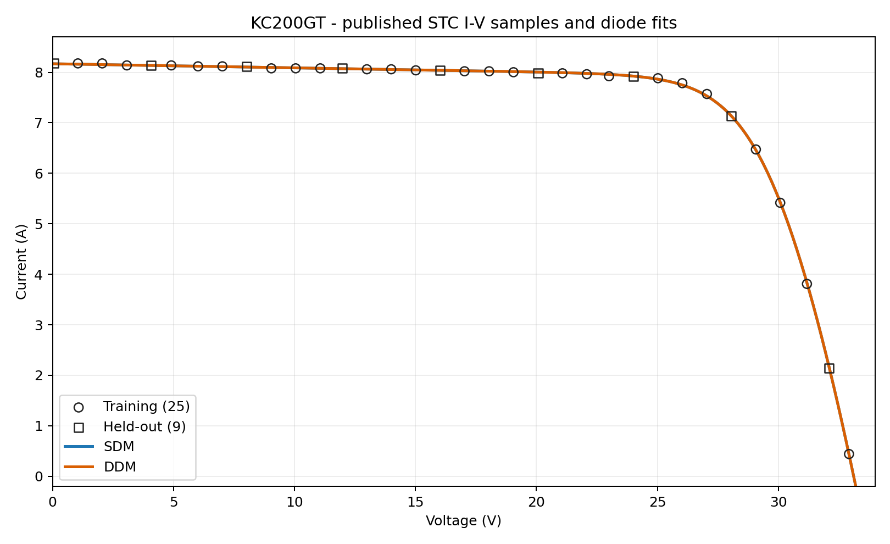

# KC200GT — Solar PV Single- and Double-Diode Modeling and Validation

  

**Reproducible modeling of the Kyocera KC200GT 200 W photovoltaic module.** This repository fits a 5-parameter **single-diode model (SDM)** and a 7-parameter **double-diode model (DDM)** to published experimental current–voltage data, evaluates interpolation error on held-out points, and compares extrapolated maximum power to a **manufacturer NOCT reference**. Irradiance/temperature sweeps are clearly labeled predictions, not measurements.



## Actual reproducible results

**Source:** 34 published KC200GT I–V points, Cotfas et al. (2021), Table 21, recorded at **1000 W/m²** irradiance and **25°C cell temperature**. The split is fixed before fitting (25 train / 9 held-out); test points are never included in optimization.

| Criterion | Single diode (5 parameters) | Double diode (7 parameters) |
|:--|--:|--:|
| Training I–V RMSE | **0.01754 A** | 0.01754 A |
| Held-out STC I–V RMSE | **0.01050 A** | 0.01050 A |
| Predicted STC Pmax | **203.65 W** | 203.65 W |
| Predicted NOCT Pmax | **147.12 W** | 147.12 W |
| Difference from manufacturer's **142 W** NOCT rating | **+3.61%** | +3.61% |

> The DDM fit effectively **collapses toward an SDM** for this dataset (the second saturation current becomes ~1e-13 A). The extra diode has no meaningful predictive advantage under this constrained fit. This is a result, not a bug. Exact values and full precision are in [`results/model_comparison.csv`](results/model_comparison.csv) and [`results/fitted_parameters.csv`](results/fitted_parameters.csv).

**Important reference mismatch:** The discrete maximum `max(V_measured × I_measured)` is **204.737 W** in the published curve; Kyocera's nominal rating is **200 W**, and its rounded Vmp × Imp values yield **200.143 W**. The datasets and the rounded nominal specification must not be equated.

## Reproduce in Python (fully executed and tested)

```bash
git clone https://github.com/DamnedWolf69/kc200gt-pv-validation.git
cd kc200gt-pv-validation
python -m venv .venv
# Linux/macOS: source .venv/bin/activate
# Windows: .venv\Scripts\activate
python -m pip install -e '.[dev]'
python -m pytest -q
python -m kc200gt.analysis
```

The local project ZIP does not need cloning. Extract it, open its root folder in a terminal, then run `python -m pip install -e '.[dev]'`. The editable install is essential because the importable `kc200gt` package lives under `src/`. The complete pipeline was executed in Python (SciPy + NumPy + Matplotlib), with **8 automated tests passing**. No API keys, internet or manual data entry are required after dependency installation.

## Reproduce in MATLAB

Open **`matlab/run_KC200GT_MATLAB.m`** and click *Run*. Requires **MATLAB R2019b+** and **Optimization Toolbox** (`lsqnonlin`). It reads the same CSV, uses the same train/test split and multi-start seeds, and writes MATLAB tables and plots to `matlab/results_local/`.

**Verification status:** Python was executed end-to-end here; the MATLAB script was authored for MATLAB but **was not runtime-tested in MATLAB** because MATLAB was not available in the execution environment. Small numerical deviations between optimizers are possible.

## File map

```text
kc200gt-pv-validation/
├── src/kc200gt/
│   ├── model.py                 # SDM/DDM physics + implicit I-V current solver
│   ├── fit.py                   # bounded multi-start least squares
│   └── analysis.py              # metrics, exports, all 7 figures
├── matlab/run_KC200GT_MATLAB.m # native MATLAB model + analysis
├── data/
│   ├── kc200gt_stc_cotfas2021_table21.csv  # published measurements
│   └── README.md                 # data provenance
├── tests/test_models.py         # 8 verified tests
├── figures/                     # 7 published PNG and SVG figures
├── results/
│   ├── REPORT.md                 # actual execution summary
│   ├── metrics.json              # machine-readable numerical results
│   ├── model_comparison.csv      # RMSE / Pmax / NOCT errors
│   ├── fitted_parameters.csv     # extracted SDM/DDM parameters
│   ├── pointwise_predictions.csv # every prediction and residual
│   ├── split_manifest.csv        # leakage-free train/test indexing
│   └── environment_sweep.csv     # 30 MODEL PREDICTIONS
├── docs/
│   ├── METHODS.md                # equations, experimental design, caveats
│   └── CV_BULLETS.md             # substantiated resume bullet options
├── .github/workflows/ci.yml     # tests/reproduction on GitHub Actions
├── CITATION.cff
├── LICENSE
├── pyproject.toml
└── README.md
```

## 7 generated figures

| Figure | Meaning |
|:--|:--|
| [`01_stc_iv_fits.png`](figures/01_stc_iv_fits.png) | SDM/DDM fits vs actual training and held-out I–V samples |
| [`02_stc_pv_fits.png`](figures/02_stc_pv_fits.png) | Sampled and modeled P–V curves with datasheet reference |
| [`03_test_residuals.png`](figures/03_test_residuals.png) | Actual held-out current errors versus voltage |
| [`04_irradiance_iv_predictions.png`](figures/04_irradiance_iv_predictions.png) | I–V prediction for 200–1000 W/m² |
| [`05_temperature_iv_predictions.png`](figures/05_temperature_iv_predictions.png) | I–V prediction for 25–75°C cell temperature |
| [`06_pmax_sweep_predictions.png`](figures/06_pmax_sweep_predictions.png) | 5 × 3 irradiance/temperature scenarios per model |
| [`07_noct_rating_error.png`](figures/07_noct_rating_error.png) | Power deviation from manufacturer's NOCT nominal rating |

## What is genuinely validated?

- **Validated within one measured STC curve:** held-out current RMSE on 9 unseen *voltage coordinates* belonging to the same experimental operating condition. Because nearby training points remain, this evaluates interpolation, **not** unseen-weather generalization.
- **Benchmarked against external reference:** 800 W/m², 47°C cell temperature, manufacturer nominal NOCT Pmax 142 W. This is a **manufacturer specification**, not a full laboratory-measured I–V curve and not part of the fit.
- **Predicted, not validated:** 15 environmental settings (5 irradiance levels × 3 cell temperatures) **per model**. There are no invented extra I–V measurements or unsupported RMSE claims at these settings.
- **Model limitations:** Parameters from one STC curve can be correlated/non-unique. Both models are constrained using physical parameter bounds; DDM can collapse to the simpler model. The environmental translation extends De Soto-inspired assumptions (especially diode saturation current scaling) to DDM and ignores spectral/angle dependencies.

## Mathematical model

For the SDM, terminal current obeys

$$I=I_{ph}-I_0\left[\exp\left(\frac{V+IR_s}{nN_skT_c/q}\right)-1\right]-\frac{V+IR_s}{R_{sh}}.$$

The DDM adds a second exponential term, with \(I_{01},n_1\) and \(I_{02},n_2\). Both are solved implicitly by a damped Newton method and bounded scalar fallback. STC model parameters are fitted on the training data with bounded, multi-start nonlinear least squares and log-scaled saturation currents and shunt resistance. Maximum power is optimized continuously over `[0, Voc]` rather than from a coarse voltage grid. See [methods and equations](docs/METHODS.md).

## How to upload to GitHub

Create an **empty public repository** named `kc200gt-pv-validation` on GitHub, then from this extracted folder run:

```bash
git init
git add .
git commit -m "Reproducible KC200GT PV diode-model validation"
git branch -M main
git remote add origin https://github.com/DamnedWolf69/kc200gt-pv-validation.git
git push -u origin main
```


## References and attribution

1. D. T. Cotfas, A. M. Deaconu, and P. A. Cotfas, "Hybrid successive discretisation algorithm used to calculate parameters of the photovoltaic cells and panels for existing datasets," *IET Renewable Power Generation*, 2021, Table 21, [DOI: 10.1049/rpg2.12262](https://doi.org/10.1049/rpg2.12262).
2. Kyocera, *KC200GT Photovoltaic Module Datasheet*, [manufacturer datasheet reproduction](https://www.energymatters.com.au/images/kyocera/KC200GT.pdf). Nominal STC and NOCT ratings.
3. PV Performance Modeling Collaborative (Sandia/NIST), [De Soto five-parameter module model](https://pvpmc.sandia.gov/modeling-guide/2-dc-module-iv/single-diode-equivalent-circuit-models/de-soto-five-parameter-module-model/).

The MIT license covers the original project code and documentation, not third-party materials; measurements are attributed to their publication.

## Student extension: four-fold held-out robustness

Run `python experiments/holdout_robustness.py` after installing this package.
The experiment refits each model four times, withholding every fourth observation
with offsets 0, 1, 2, and 3. Each observed point is tested once. It outputs
`results/holdout_robustness.csv`. These folds remain within one STC curve;
they **do not** constitute new-weather validation. The mean of four fold RMSEs
is an equally weighted fold summary, not the pooled 34-point RMSE.

## Four-fold robustness experiment (executed)

```bash
python experiments/holdout_robustness.py
```

Folds withhold each index-modulo-4 subset in turn, with 25/9 or 26/8 train/test points. Both models return **0.017885 A mean fold RMSE** (17.885 mA; unweighted mean over four folds). Full precision and each split are in [`results/holdout_robustness.csv`](results/holdout_robustness.csv). Because all folds come from the same STC I-V curve, this demonstrates within-curve robustness, **not** across-weather generalization.
